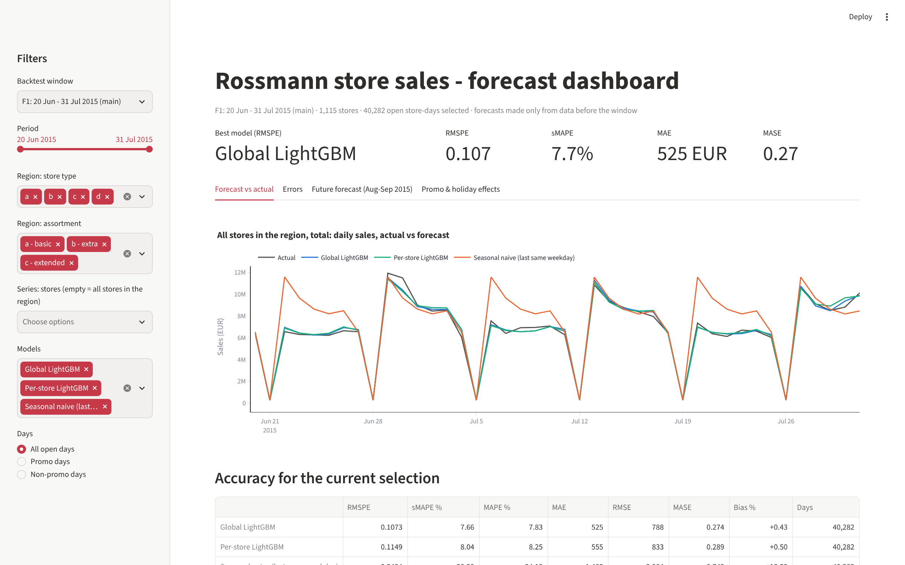

# Rossmann Store Sales Forecasting

**Forecast daily sales of 1,115 Rossmann drugstores and measure the effect of promotions and holidays.**
Course project · Cluster 10 · Forecasting & Open Data Analytics.
Team: **Sultan Aybolatov, Ibragim Kuandykov, Sultan Khabibulin** (contributions [below](#team-and-contributions)).

| | |
|---|---|
| Data | Kaggle *Rossmann Store Sales*: 1,017,209 store-days, 1,115 stores, 1 Jan 2013 – 31 Jul 2015 ([source](https://www.kaggle.com/competitions/rossmann-store-sales/data), see [`data/README.md`](data/README.md)) |
| Hold-out | last 6 weeks: **20 Jun – 31 Jul 2015** (42 days), plus two earlier 6-week windows as rolling-origin backtests |
| Metrics | **RMSPE** (Kaggle metric), **sMAPE**, MAPE, MAE, RMSE, **MASE**, bias – on open days with sales > 0 |
| Tools | pandas, statsmodels, scikit-learn, LightGBM, Plotly, matplotlib |

## Key results

Main hold-out F1 (20 Jun – 31 Jul 2015, 40,282 open store-days):

| Model | Models fitted | RMSPE | sMAPE | MAE (EUR) | RMSE (EUR) | MASE | Bias | Train time | Mean RMSPE, 3 windows |
| --- | ---: | ---: | ---: | ---: | ---: | ---: | ---: | ---: | ---: |
| **Global LightGBM** | 1 | 0.107 | 7.7% | 525 | 788 | 0.27 | +0.4% | 244 s | 0.099 |
| Per-store LightGBM | 1,115 | 0.115 | 8.0% | 555 | 833 | 0.29 | +0.5% | 132 s | 0.116 |
| Per-store ridge regression | 1,115 | 0.125 | 8.9% | 622 | 931 | 0.32 | 0.0% | 7 s | 0.117 |
| Store x weekday x promo profile | 1,115 | 0.135 | 9.8% | 678 | 1,022 | 0.35 | -1.0% | < 1 s | 0.144 |
| Seasonal naive (last same weekday) | 1,115 | 0.349 | 20.2% | 1,485 | 2,084 | 0.74 | +13.6% | < 1 s | 0.315 |
| Naive (last observed day) | 1,115 | 0.393 | 23.4% | 1,623 | 2,059 | 0.82 | +8.9% | < 1 s | 0.371 |

Per-store SARIMAX (statsmodels) was fitted on a random sample of 150 stores: RMSPE 0.140 vs 0.105 for the global LightGBM on the same stores.

**Findings**

* **Global beats per-store.** One LightGBM for all stores has the lowest error on the main hold-out and on both earlier
  windows, and beats the 1,115 per-store LightGBM models for 66% of stores.
* **Promo +38%.** A promo day raises sales by 37.9% (95% CI 36.2–39.7%),
  through 20% more customers and 15% larger baskets; strongest on Mondays, weakest in type-b stores.
  The continuing Promo2 coupon months show no measurable effect (-0.3%).
* **Holidays shift demand.** Stores close on state holidays; sales rise 19% the day before and
  23% the day after, and up to 69% on 23 December. School holidays matter little (+1.1%).
* **Model-based check.** Turning each promo week of the hold-out into a regular week in the global model's forecast implies a
  37% promo-day uplift, worth about €38M (13.5% of hold-out sales) in six weeks.

All figures: [`outputs/figures/`](outputs/figures) · all tables: [`outputs/metrics/`](outputs/metrics).

## Dashboard

```bash
streamlit run app/dashboard.py        # after run_pipeline.py; reads outputs/rossmann_results.sqlite
```

Filters: backtest window and **period**, **region** (store type and assortment – the data has no geography),
**series** (one or more stores, or all), models, promo / non-promo days. Tabs: forecast vs actual with live
metrics (RMSPE, sMAPE, MAPE, MAE, RMSE, MASE, bias), errors by week and by store, the forecast for the Kaggle
period (1 Aug – 17 Sep 2015), promo and holiday effects with correlations.



## Team and contributions

| Member | Role | Contribution |
| --- | --- | --- |
| Sultan Aybolatov | Data and time-series analysis | chunked CSV loading with dtypes, Parquet vs CSV benchmark (size, memory, time), merge and cleaning, descriptive statistics, missing values, outliers, time-index frequency and continuity check, resampling and rolling means, MSTL (STL) decomposition, ADF/KPSS, ACF/PACF – notebook 01, report section 2 |
| Ibragim Kuandykov | Forecasting models and evaluation | feature engineering, naive / seasonal-naive / profile baselines, per-store ridge, SARIMAX and LightGBM, global LightGBM, chronological hold-out and rolling-origin backtests, metrics (MAE, RMSE, MAPE, sMAPE, RMSPE, MASE), error analysis by week, store and segment, Kaggle submission – notebook 02, report sections 3–4 |
| Sultan Khabibulin | Promo / holiday effects, external factors, dashboard | fixed-effects regressions of promo and holiday effects, counterfactual and ablation, correlation analysis with external factors, Plotly interactive charts, Streamlit dashboard, SQLite / Parquet export – notebook 03, report sections 5–6 |
| All three | | research question, report and presentation, conclusions, code review |

## Coverage of the mandatory tasks

| Task | Where |
| --- | --- |
| EDA: descriptive statistics, missing values, outliers, frequency and continuity of the time index; chunked loading and Parquet with memory measurement | notebook 01 §1–3, `src/rossmann/data.py`, `outputs/` of notebook 01 (load benchmark) |
| Time series: resample, rolling means, seasonal decomposition (STL/MSTL), stationarity (ADF, KPSS), ACF/PACF | notebook 01 §4–6 |
| Chronological hold-out and rolling-origin backtest without shuffling; naive and seasonal-naive baselines; ≥ 2 models | notebook 02, `src/rossmann/models.py`: naive, seasonal naive, profile, ridge, SARIMAX (ARIMA), per-store and global LightGBM |
| Metrics MAE, RMSE, MAPE/sMAPE, MASE (+ RMSPE); quality and training time; errors by period and series | `outputs/metrics/backtest_metrics.csv`, `by_week.csv`, `per_store.csv`, `segments.csv`, notebook 02 |
| 4–5 visualisations, ≥ 1 interactive (Plotly); correlation with external factors (holidays, promotions, competition) | 14 PNG figures + 3 interactive HTML in `outputs/figures/`; correlations in notebook 03 §4, `correlations_*.csv` |
| Mini dashboard (Streamlit) with filters for period, region and series, with forecasts; results saved to Parquet / SQLite | `app/dashboard.py`, `outputs/rossmann_results.sqlite`, `outputs/predictions/*.parquet` |

## Repository layout

```
├── README.md                 this file – run instructions and results
├── requirements.txt          Python dependencies
├── run_pipeline.py           one command that reproduces every number and figure
├── app/
│   └── dashboard.py          Streamlit dashboard (filters: period, region, series, models)
├── data/
│   ├── README.md             where to get the Kaggle files
│   └── raw/                  put train.csv, store.csv, test.csv, sample_submission.csv here
├── notebooks/
│   ├── 01_eda_data_timeseries.ipynb   data loading, cleaning, EDA, MSTL, ADF/KPSS, ACF/PACF (Colab)
│   ├── 02_forecasting_models.ipynb    features, models, hold-out evaluation, per-store vs global
│   └── 03_promo_holiday_effects.ipynb promo and holiday effects (fixed-effects regression, counterfactuals)
├── src/rossmann/
│   ├── config.py             paths, hold-out dates, seed
│   ├── data.py               chunked CSV loading with dtypes, merge, data-quality flags
│   ├── features.py           calendar / promo / holiday / closure / store features on a full daily grid
│   ├── models.py             baselines, per-store ridge / SARIMAX / LightGBM, global LightGBM
│   ├── metrics.py            RMSPE, sMAPE, MAPE, MAE, bias
│   ├── effects.py            descriptive, fixed-effects OLS and counterfactual promo/holiday effects
│   ├── plots.py              report figures (matplotlib) and interactive charts (Plotly)
│   └── pipeline.py           end-to-end orchestration
└── outputs/
    ├── figures/              PNG figures used in the report and slides + interactive HTML
    ├── metrics/              every table as CSV (backtests, per store, segments, effects …)
    ├── predictions/          hold-out predictions of all models (parquet)
    ├── rossmann_results.sqlite   all results in one SQLite file (dashboard data source)
    ├── submission.csv        Kaggle submission (Aug–Sep 2015)
    └── summary.json          headline numbers
```

## How to run

Python 3.10+ (tested with 3.12, pandas 3.0, LightGBM 4.7, statsmodels 0.15).

```bash
git clone <this repository> && cd rossmann-sales-forecasting
python -m venv .venv && source .venv/bin/activate        # Windows: .venv\Scripts\activate
pip install -r requirements.txt

# 1. data: put the 4 Kaggle CSV files in data/raw/ (see data/README.md)

# 2. smoke test (60 stores, 1 hold-out window, ~2 min)
python run_pipeline.py --quick

# 3. full run (all 1,115 stores, 3 backtest windows, effects, Kaggle submission; ~40 min on 2 CPU cores)
python run_pipeline.py

# 4. notebooks (read the results of step 3; set RUN_PIPELINE = True in notebook 02 to retrain inside it)
jupyter notebook notebooks/

# 5. dashboard
streamlit run app/dashboard.py
```

Useful options: `--folds 1` (main hold-out only, ~12 min), `--sarimax-stores 0` (skip SARIMAX),
`--no-effects`, `--no-submission`, `--raw-dir PATH` (CSV files elsewhere), `--rebuild` (rebuild the cached parquet files).
Running on Google Colab: upload the repository, `pip install -r requirements.txt`, copy the CSV files to `data/raw/`, then `!python run_pipeline.py`.

Notebook 01 was written for Google Colab (it asks for the CSV files with an upload dialog). The pipeline does not
need it: `rossmann.data.build_clean` reproduces its `clean.parquet` with the same rules.

## Method in short

1. **Data** — chunked CSV load with explicit dtypes (RAM 160 MB → 20 MB, Parquet 36 MB → 4 MB), merge with
   `store.csv`, flags for 54 open-but-zero-sales days and 1,113 extreme outliers (kept), 180 stores missing
   Jul–Dec 2014. Weekly seasonality dominates (MSTL strength 0.94), yearly is clear (0.86).
2. **Features** — computed on a complete store × day grid using only information known in advance: calendar,
   promo calendar (promo day, promo next/last week, Promo2), holiday distances (state, Christmas, Easter, school),
   closures/refurbishments, store attributes, and store history statistics from the training window only.
3. **Models** — seasonal naive, store × weekday × promo profile, per-store ridge, per-store SARIMAX (regression with
   ARMA errors, 150-store sample), per-store LightGBM (1,115 models), global LightGBM (1 model).
   Learned models fit `log1p(Sales)`; trees are chosen on a 6-week inner validation window and refit before the hold-out.
4. **Effects** — store fixed-effects regression of log sales (statsmodels, two-way clustered SEs), decomposition into
   customers × basket, heterogeneity by weekday / store type, counterfactual forecasts and feature ablation.

## Reproducibility notes

* Seeds fixed (`config.SEED = 42`); LightGBM multithreading may change the last decimals between machines.
* The hold-out is never used to choose anything (trees, correction factor, features).
* `outputs/` holds the results of the run described in the report (15 Nov 2026); a full run from scratch takes about 40 minutes on 2 CPU cores. Finished backtest windows and effect regressions are cached in `outputs/cache/` (git-ignored); `--rerun` ignores the cache.
